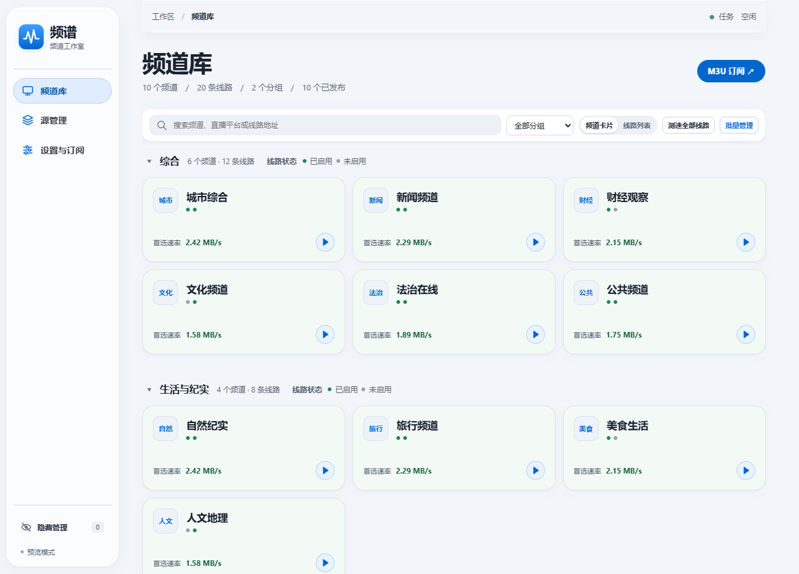
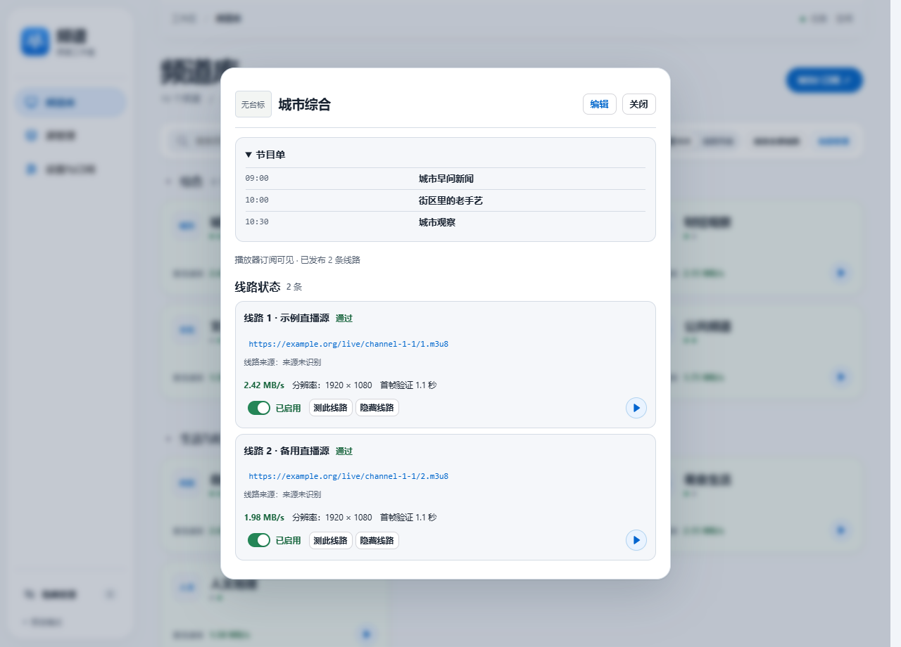
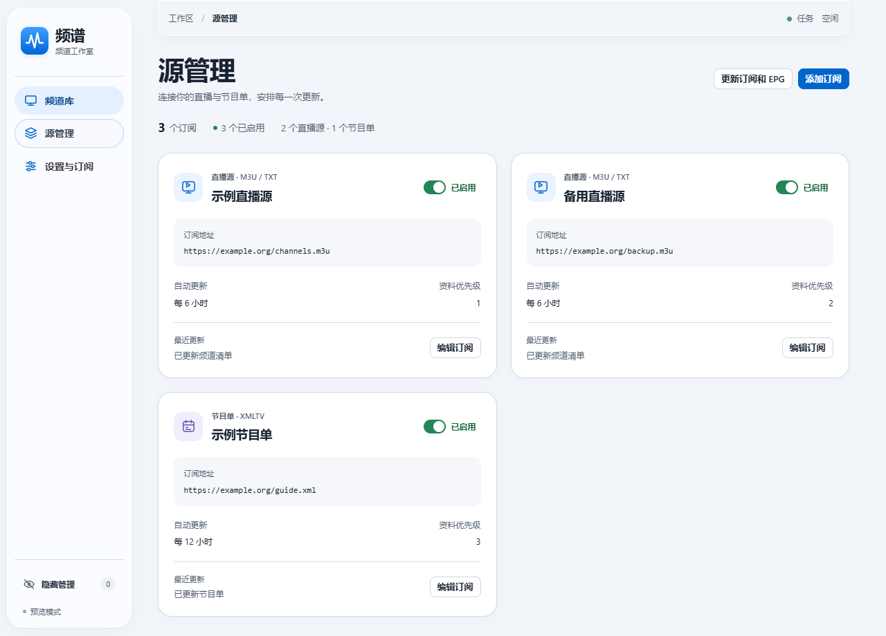
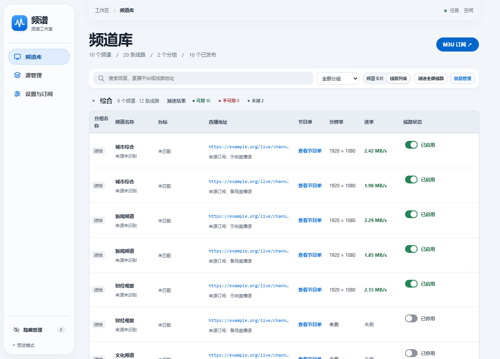

<div align="center">

# 频谱 · IPTV Studio

**在一个频道库里管理多个直播订阅，为同一频道保留多条线路，检测后发布统一播放列表。**

自托管 · 多线路 · 深度检测 · NAS 友好

[界面预览](#界面预览) · [核心功能](#核心功能) · [快速部署](#快速部署) · [开始使用](#开始使用) · [播放器地址](#播放器地址) · [本地开发](#本地开发)

[下载发行版](https://github.com/Ringas/iptv-studio/releases/latest) · [Docker Hub](https://hub.docker.com/r/talktoo/iptv-studio)

</div>

IPTV Studio（频道频谱）是一个面向 NAS 与家庭服务器的 **自托管 IPTV 管理工具**。它不内置直播源：你导入自己的 M3U / 分组 TXT 订阅后，把同名频道合并到同一频道下，为每条线路分别试看与检测，再按质量启停，向电视和播放器输出一份干净的统一订阅。

例如两个订阅都收录了 CCTV-1，可以归入同一个频道，分别比较两条线路的分辨率与实测速率，只发布能播、达标的那一条（或保留多线备用）。

> **访问说明：** 推荐在可信内网或 VPN 中部署。播放列表中的媒体地址通常由播放器直连上游；能访问订阅地址的人可能看到其中的播放源。公网部署请配置 HTTPS 反向代理，并在「设置与订阅 → 管理台访问」设置密码。

## 界面预览

以下截图使用示例频道、节目单和订阅地址。

**频道库** · 按分组浏览频道。每个色点代表一条线路，绿色表示已启用，灰色表示未启用。



<details>
<summary>频道详情 · 查看节目单、比较同一频道的两条线路</summary>



</details>

<details>
<summary>源管理 · 查看直播订阅和 XMLTV 节目单的更新计划</summary>



</details>

<details>
<summary>线路列表 · 同频道多线路的分辨率、速率与启停</summary>



</details>

## 为什么选择 IPTV Studio

| 🔀 多线路合并 | 🔬 深度可用性检测 | 📡 统一发布 |
| --- | --- | --- |
| 多个订阅中的同名频道归入一个频道，每条线路保留地址、来源与检测结果；相同 URL 去重，不同地址作备用 | 解析清单、读取媒体、尝试解码，并观察直播分片是否推进；记录分辨率、实测速率、起播耗时与失败原因 | 导出 M3U / TXT / JSON / XMLTV，可择优单线或保留多线，供电视与播放器订阅 |
| 🧪 **网页试看** | 📅 **EPG 节目单** | 🏠 **NAS 友好** |
| 在管理台直接试看，复核实际播放效果 | 导入 XMLTV，自动匹配或手动关联；支持订阅声明的节目单及部分传输流中的 DVB EIT | Docker Compose 一键部署，数据落在本地 `./data`，适合家庭服务器 |

## 核心功能

### 线路管理与同频道合并

- 多个订阅中的同名频道可统一归入一个频道；每条线路分别保留地址、来源订阅和检测结果。
- 同一频道下相同完整 URL 去重，不同地址作为备用线路保留；名称不同的频道可在详情中手动合并或拆分。
- 线路列表支持搜索与按分组筛选；可单独或批量启用、停用、隐藏线路。
- 频道、分组和单线路均可恢复；人工整理在订阅更新后保留。

### 直播源可用性检测

- 支持单条或批量检测：解析直播清单、读取媒体、尝试解码视频，并观察直播分片是否继续推进。
- 记录每个地址的 **分辨率、实测速率、起播耗时和失败原因**。
- 可按速率、分辨率或两者同时达标的条件筛选后发布；检测通过的线路可按规则自动启停，也可手动调整。
- 暂时失败的线路按规则冷却复测；批次检测可跳过当前线路或终止整批。
- 网页试看便于复核效果。一次短时检测结果会受上游与网络变化影响，重要线路建议结合试看判断。

### 节目单、订阅与播放器接入

- **EPG**：导入 XMLTV，自动匹配或手动关联频道；也支持订阅声明的节目单和支持的传输流中的 DVB EIT。
- **订阅更新**：分别设置直播与节目单订阅的更新间隔，查看更新结果与失败原因。
- **统一发布**：导出 M3U、TXT、JSON 和 XMLTV；可保留同频道多条线路或择优输出。

## 快速部署

安装 Docker 与 Compose 后，在空目录执行：

```bash
curl -fsSL https://raw.githubusercontent.com/Ringas/iptv-studio/main/compose.yaml -o compose.yaml
docker compose pull
docker compose up -d
