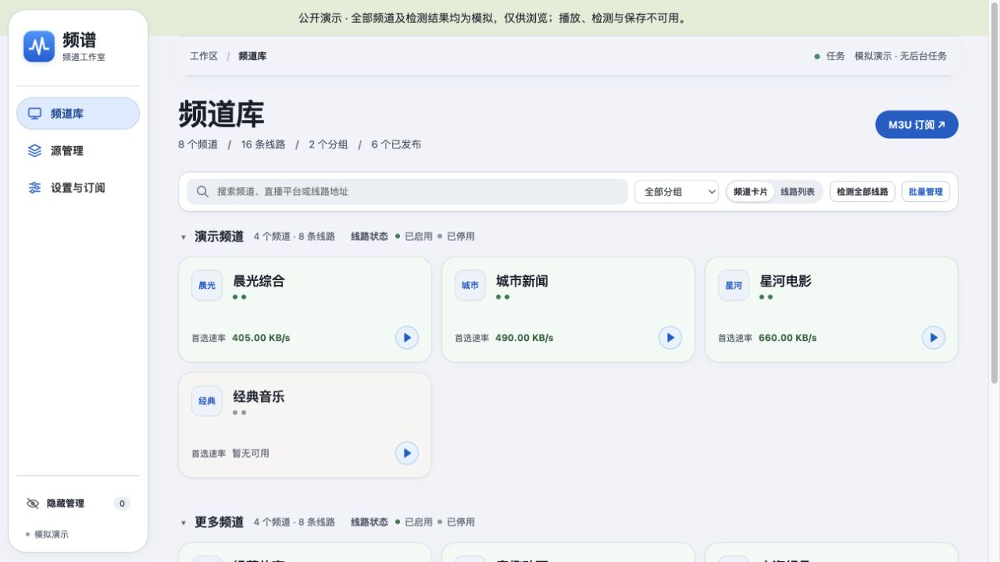
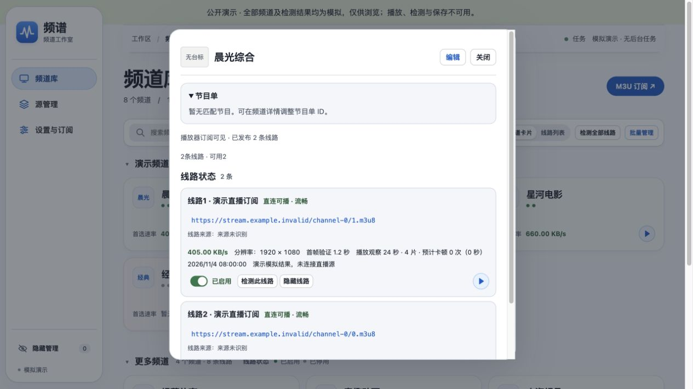

<div align="center">

# 频谱 · IPTV Studio

**合并直播订阅，比较多条线路，发布统一播放列表。**

自托管 · 多线路择优 · 直播检测 · 节目单 · NAS 部署

[在线 Demo](https://ringas.github.io/iptv-studio/) · [界面预览](#界面预览) · [快速部署](#快速部署) · [检测与启停](#检测与启停) · [本地运行](#本地运行)

[发行版](https://github.com/Ringas/iptv-studio/releases) · [Docker Hub](https://hub.docker.com/r/talktoo/iptv-studio)

</div>

IPTV Studio 是面向 NAS、家庭服务器和本地电脑的 IPTV 管理工具。导入 M3U 或分组 TXT 后，同名频道归入同一频道，保留多条线路；检测、整理并启停线路后，向电视或播放器输出统一订阅。

项目不提供直播源。README 截图与静态 Demo 均使用虚构频道、模拟检测结果和 `.invalid` 示例地址，不包含家庭订阅或真实媒体。

## 界面预览

**频道库**：每个色点代表一条线路的启停状态；首选速率对应默认播放的线路，没有达标首选时显示“暂无可用”。



<details>
<summary>线路列表：比较分辨率、速率与启停状态</summary>


</details>

<details>
<summary>频道详情：查看线路、检测结果及频道设置</summary>



</details>

<details>
<summary>源管理：管理订阅与更新计划</summary>


</details>

<details>
<summary>设置与订阅：更新间隔、检测方式、通过条件与导出</summary>


</details>

## 主要功能

| 功能 | 用法 |
| --- | --- |
| 频道整理 | 合并同名频道；手动改名、分组、合并或拆分；隐藏和恢复频道、分组、线路 |
| 多线路管理 | 同频道相同完整 URL 去重；保留来源；单条或批量启停、检测 |
| 线路择优 | 依据当前达标情况、流畅性、失败与重连记录、画质和速率排序 |
| 网页试播 | 点击卡片播放首选线路，在播放器中切换线路；切换仅影响本次播放 |
| 更新计划 | 分订阅配置更新间隔，支持更新后自动检测，查看任务记录 |
| 节目单 | XMLTV 导入、自动匹配和手动关联；支持订阅声明的节目单及部分传输流中的 DVB EIT |
| 统一输出 | M3U、分组 TXT、JSON、XMLTV；可保留多线或每频道仅发布最佳线路 |

## 快速部署

### Docker Compose

安装 Docker 和 Compose，在新目录执行：

```bash
curl -fsSL https://raw.githubusercontent.com/Ringas/iptv-studio/main/compose.yaml -o compose.yaml
docker compose pull
docker compose up -d
```

打开 `http://服务器IP:8787`。Compose 使用 `init: true` 回收子进程，容器内监听 `PORT=8787`；`mport` 不是本项目支持的配置。数据保存在当前目录的 `./data`，容器重建后继续使用此目录。

默认 Compose 使用已发布的 `talktoo/iptv-studio:latest` 镜像。**GitHub main 的代码更新不等于镜像已更新**。需要使用当前源码时，在仓库目录自行构建：

```bash
git clone https://github.com/Ringas/iptv-studio.git
cd iptv-studio
docker build -t iptv-studio:local .
docker run -d --name iptv-studio-local --restart unless-stopped \
  --init -p 8787:8787 -v "$(pwd)/data:/app/data" iptv-studio:local
```

已有服务时先停止旧实例，避免两个进程共用数据库或端口。升级前停止服务并备份整个数据目录；升级镜像可使用 `docker compose pull && docker compose up -d`。不要删除数据目录，也不要用空目录替换原挂载目录。

### 首次使用

1. 在「源管理」添加直播订阅，导入频道；有节目单时添加 XMLTV 订阅。
2. 在「设置与订阅」选择检测方式和通过条件，保存设置。
3. 点击「检测全部线路」，或在详情、线路列表中检测指定线路。
4. 复核结果并整理频道。手动启停立即生效；试播本身不改变启停。
5. 将「设置与订阅」中的 M3U、TXT 或 JSON 地址填入播放器，按需配置 XMLTV 节目单地址。

## 检测与启停

### 三种检测方式

| 方式 | 适用情况 | 验证取舍 |
| --- | --- | --- |
| 快速检测 | 大批量初筛、快速了解线路状态 | 验证窗口较短，结果不能等同于长时间稳定性验证 |
| 均衡检测 | 日常更新和多线路比较 | 粗筛接续连续精测，复用下载与解码证据；受控双线路调度，同网关串行，不达标线路隔离复核 |
| 深度检测 | 重点线路复核 | 连续观察解码和直播推进，以更多时间换取更充分的证据 |

三种方式使用同一组通过门槛，但采样时长与证据充分程度不同。连续精测检查多帧解码、时间戳与直播推进；不是只看 HTTP 200 或清单标注的分辨率。

新建配置默认使用**快速检测**，同时要求实测速率 **严格大于 100 KB/s**、画面高度 **至少 720 像素**。KB/s 是每秒字节速率，不是 kbps。设置可改为仅速率达标、仅分辨率达标，或调整数值门槛；已有用户设置保留，不会因升级强制改回默认值。

### 结果、当前达标与启停分别表示什么

- **当次检测结果**：该次采样的证据、时间和当时门槛，作为历史记录保留。
- **当前是否达标**：按现在的通过条件重新评估已有证据。降低门槛不能补齐缺失的解码或推进证据，未完成验证仍需再次检测。
- **线路启停**：决定是否进入播放器订阅。手动操作立即生效，不要求先达到自动检测门槛。

429 限流、网络策略拦截和临时超时保留为未能验证，不能直接认定废源；可按规则冷却、隔离复核。检测全部线路包含可见的未测、不达标和手动停用线路，隐藏线路及停用订阅不在此范围内。

### 自动检测与手动操作

新建配置默认开启更新计划，间隔 **8 小时**，并开启更新后检测、按检测结果自动启停。订阅可单独设置更新间隔。

开启「按检测结果自动启停」时，以下四个入口使用一致规则：更新计划中的更新后检测、检测全部线路、检测所选线路、检测此线路。

- 某线路的**首测取得有效达标或不达标结果**后，清除该线路的手动覆盖，恢复按结果自动启停。
- 未检测到的线路，以及限流、超时等未能验证的结果，保持原启停状态。
- **同一次任务内的异常复测**只更新检测记录与提示，不再次改变启停状态。
- 关闭自动启停后，检测不会覆盖手动启停。

没有“恢复自动”按钮；对线路再次发起检测并取得有效首测结果即可。单纯更新订阅、打开试播或切换播放线路不等于自动检测。

## 首选线路与订阅一致性

已启用线路优先。对于同样达标、流畅且无失败的线路，优先比较画质和速率，不因成功检测次数较多而优先；失败、重连和卡顿仍会降权。

检测结果更新、通过条件保存或手动启停后会重新排序，线路继续命名为“线路1、线路2……”。频道卡片默认播放、首选速率、线路列表和订阅导出使用同一排序。保留多线时按此顺序输出；仅发布最佳线路时输出首条已启用线路。

手动启用未达标线路仍可发布和播放，但不展示为达标速率；全部停用时不发布该频道，管理台仍可显式试播。卡片色点表示启停，不代表已通过检测。

## 本地运行

需要 **Python 3.10+、Node.js 22+、FFmpeg**。服务端使用 Python 标准库和 SQLite，不需要安装第三方 Python Web 框架或 npm 依赖。

```bash
git clone https://github.com/Ringas/iptv-studio.git
cd iptv-studio
DATA_DIR=./data BIND=127.0.0.1 PORT=8788 python3 app.py
```

打开 `http://127.0.0.1:8788`。Node 和 FFmpeg 应在 PATH 中；FFmpeg 可通过 `FFMPEG_BIN` 指定路径。局域网访问时将 `BIND` 改为本机局域网 IP，并使用该 IP 打开页面。

| 配置 | 作用 |
| --- | --- |
| `DATA_DIR` | 数据目录，保存 SQLite 数据库等持久内容 |
| `BIND` | 监听地址，本地调试建议用 `127.0.0.1` 或指定局域网 IP |
| `PORT` | HTTP 服务端口 |
| `FFMPEG_BIN` | FFmpeg 可执行文件路径 |

已有本地环境可用 `start-local.command` 固定启动配置。它读取被 Git 忽略的 `.env.local`，其中需设置 `BIND`、`PORT`、`DATA_DIR`、`PYTHON_BIN`、`NODE_BIN`、`FFMPEG_BIN`。路径请填写本机实际绝对路径；该脚本要求原数据库已存在，避免误建空库。

```bash
./start-local.command --check  # 仅检查配置、依赖与原数据库
./start-local.command          # 启动原数据目录的服务
```

直接运行 `app.py` 不会读取 `.env.local`。端口已占用时应先正常停止原进程，不要启动第二个实例。

## 常见问题

**为什么网页能打开，视频却不能播放？** 订阅可访问不代表媒体可访问。检查服务器到上游的网络、鉴权、限流及浏览器编解码支持；结合检测详情与独立播放器复核。

**为什么检测通过，长期播放仍可能卡顿？** 检测是有限时间的采样，不能保证后续网络与上游稳定，也不能由通过数量增加推断准确率提升。研究结论仅适用于记录中的样本和网络。

**订阅是否经过服务器转发媒体？** 导出的媒体地址通常由播放器直连上游；网页试播的会话代理与导出是不同路径。能取得订阅的人可能看到媒体地址，请在可信内网或 VPN 使用。公网部署需配置 HTTPS 反向代理，并在管理台设置访问密码。

**已有门槛为什么不是默认值？** 默认值仅用于新建配置，已有设置继续沿用。请在设置页调整并保存。

## 开发与验证

运行 `python3 scripts/verify_release.py` 可统一执行语法检查与全部隔离回归，也可运行根目录的 `verify*.py`、`verify*.mjs` 和独立前端检查。`verify_route_consistency.cjs` 由对应 Python 测试传入数据调用，不单独执行。

```bash
python3 verify.py
python3 verify_primary_route.py
python3 verify_route_consistency.py
python3 verify_probe_entry_control.py
node verify_card_summary.cjs
node verify_player_focus.cjs
```

测试使用隔离数据和本机模拟源；真实线路对照需要固定样本、交替版本，并计入所有重试成本。参见[两段式检测说明](docs/two-stage-detection.md)、[研究记录](research/probe/README.md)和[开发交接](DEVELOPMENT-HANDOFF.md)。

`python3 scripts/build_demo.py` 生成纯虚构数据的只读 `demo-dist/`，可部署为静态预览。缓存、数据库、日志、本地配置、依赖目录和生成目录不进入版本库；Docker 构建通过白名单仅包含运行所需文件。

## 许可证

本项目采用 **GPL-3.0-only**，详见 [LICENSE](LICENSE)。随附 HLS.js 的许可见 [hls-LICENSE.txt](hls-LICENSE.txt)。
